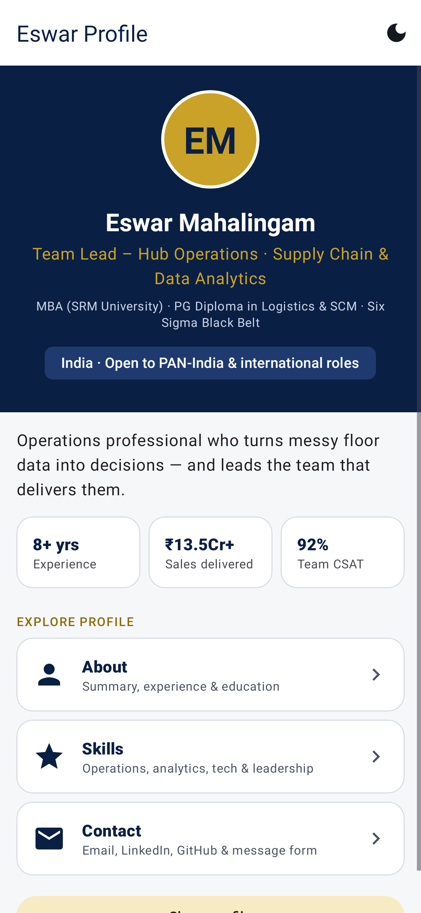
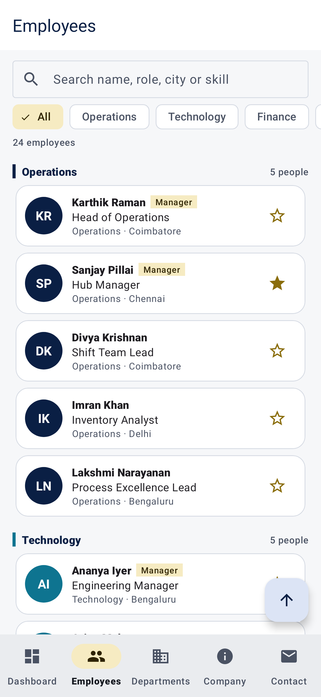
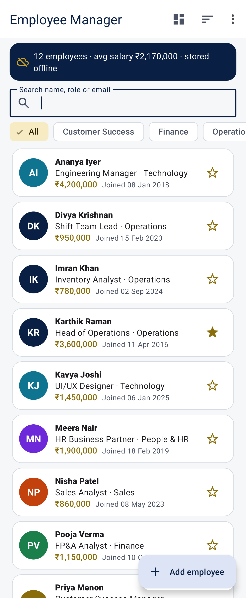

# Android App Development

**Intern:** Eswar Mahalingam · **Programme:** Sumerix Global — Android App Development · **Batch start:** 15 October 2026 · **Duration:** 36 weeks · **College / Organisation:** SRM University

| Task | Project | Focus | Tests |
|---|---|---|---|
| Task 1 — Responsive Personal Profile App | [Task-1-Personal-Profile-App](Task-1-Personal-Profile-App) | Android fundamentals, Kotlin basics, XML layouts, Activities & Intents, resources and Material Design 3 | 16 passing |
| Task 2 — Dynamic Employee Directory | [Task-2-Employee-Directory](Task-2-Employee-Directory) | Advanced Kotlin, OOP, RecyclerView, Fragments, View Binding, Navigation Component and Material Design 3 | 17 passing |
| Task 3 — Offline Employee Manager | [Task-3-Offline-Employee-Manager](Task-3-Offline-Employee-Manager) | Jetpack architecture components, MVVM, Room database, ViewModel, LiveData, Repository pattern and offline persistence | 17 passing |

| Responsive Personal Profile App | Dynamic Employee Directory | Offline Employee Manager |
|---|---|---|
|  |  |  |

Each project is a standalone Android Studio project (open its folder directly). Built and tested with Gradle 8.14.3, AGP 8.7.3 and Kotlin 2.0.21; all tests pass. Screenshots are produced by Roborazzi screenshot tests from the real layouts.
