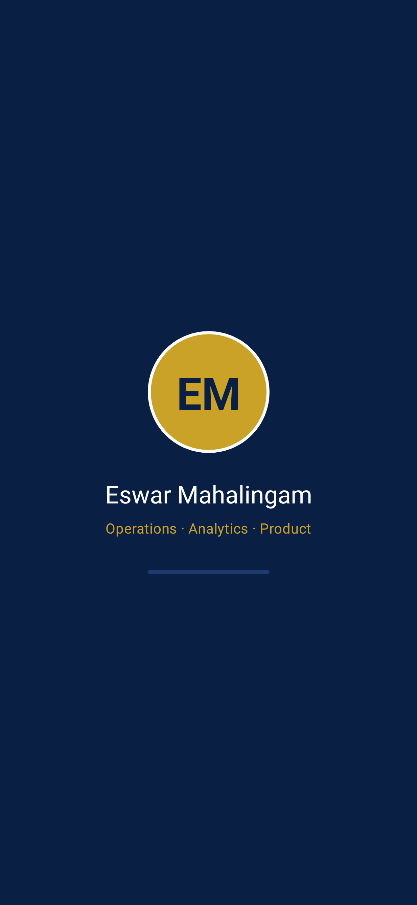
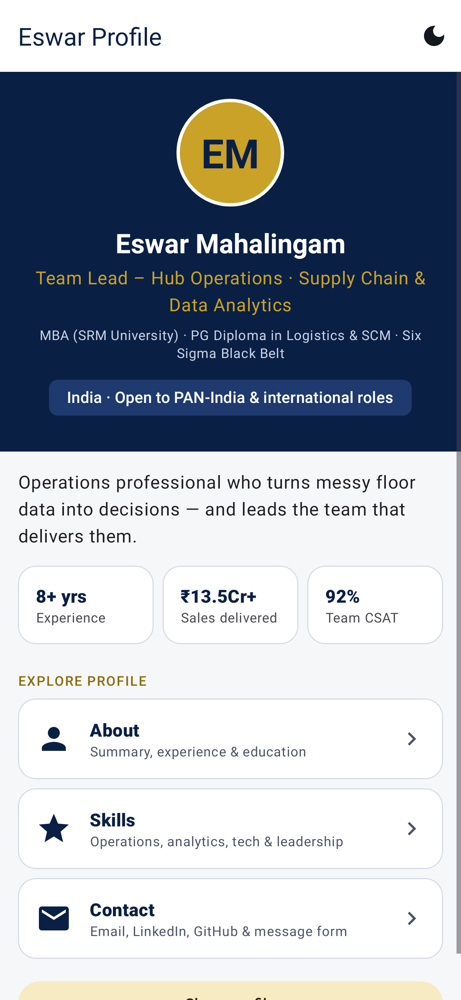
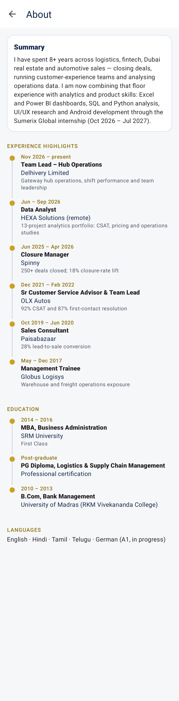
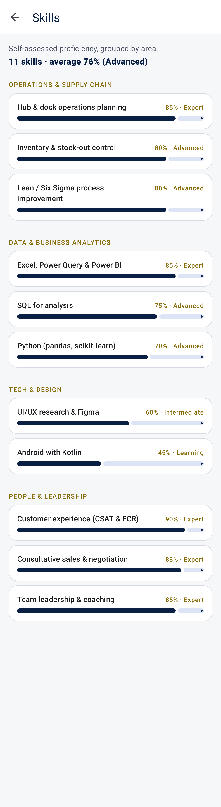
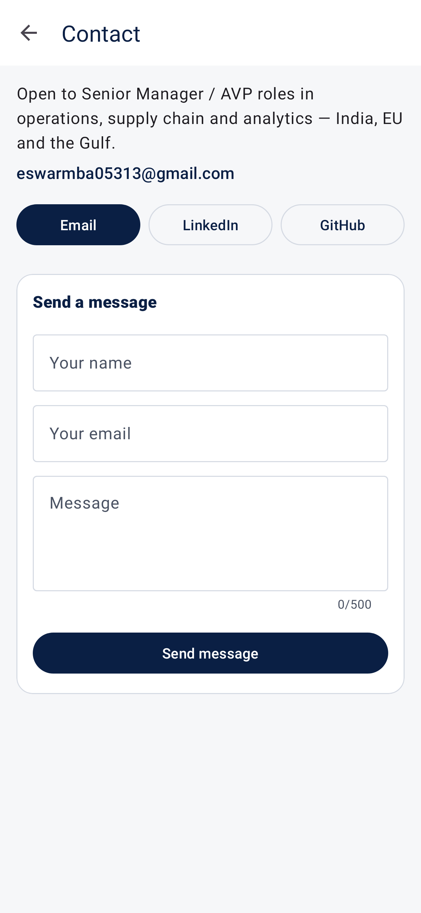
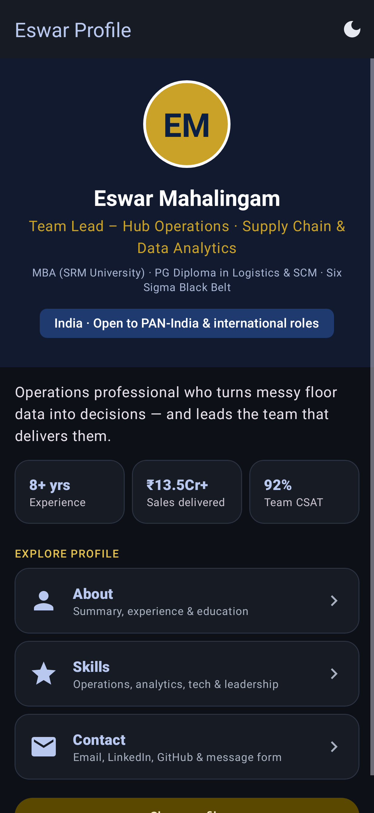
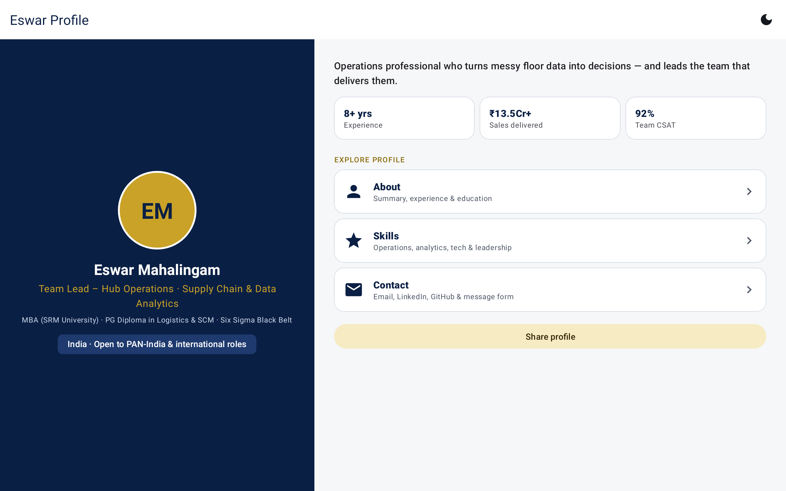
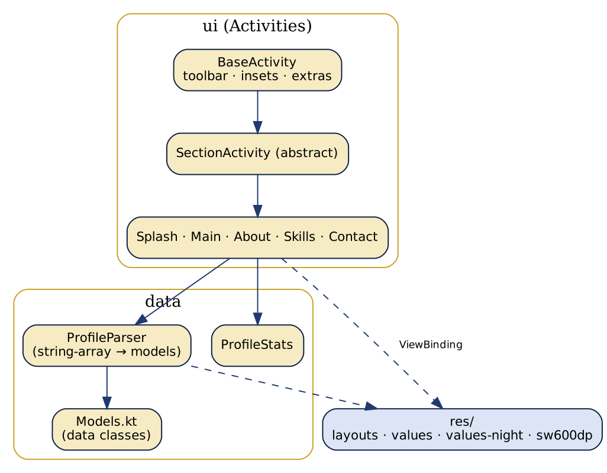
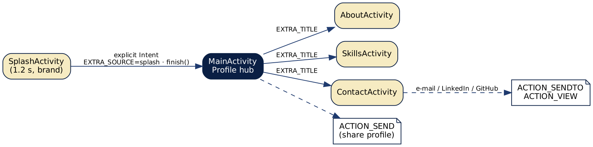

# Task 1 — Responsive Personal Profile App

**Intern:** Eswar Mahalingam · **Programme:** Sumerix Global — Android App Development · **Batch start:** 15 October 2026 · **Duration:** 36 weeks · **College / Organisation:** SRM University

Android fundamentals, Kotlin basics, XML layouts, Activities & Intents, resources and Material Design 3.

## Features
- Splash screen → Profile → About / Skills / Contact, all separate Activities connected with explicit Intents (title + source passed as extras)
- Material 3 theme with light **and dark** colour sets (`values-night`), cards, chips, progress bars and buttons
- Responsive: `layout-sw600dp` two-pane tablet profile and `values-sw600dp` dimensions
- Reusable layouts with `<include>` (hero, stats row, section cards) and item layouts for skills / timeline
- Skills with progress bars, experience & education timeline, share-profile and contact (mail / LinkedIn / GitHub) implicit Intents
- All text, colours, dimensions and styles in resources — nothing hard-coded

## Screenshots
Rendered from the real layouts with Robolectric + Roborazzi (Pixel-class phone, dark theme and 10-inch tablet configurations).

| Splash | Profile | About | Skills |
|---|---|---|---|
|  |  |  |  |

| Contact | Profile dark | Profile tablet |
|---|---|---|
|  |  |  |

## Brief coverage
| Brief part | Where it is implemented |
|---|---|
| A – Android development | Architecture diagram below; minSdk 26 / target 35, AndroidX + Jetpack |
| B – Android Studio & Gradle | Gradle Kotlin DSL, version catalogue-style plugin block, wrapper 8.14.3 |
| C – Kotlin fundamentals | `data/Models.kt` (data classes, null safety), `ProfileParser.kt` (functions, loops, when), `ProfileStats.kt` |
| D – Project structure | Manifest, `java/`, `res/` (drawable, layout, values, values-night, mipmap) — tree below |
| E – XML layouts | ConstraintLayout, LinearLayout, FrameLayout, ScrollView (+ MaterialCardView, TextInputLayout) |
| F – Views | TextView, Button, ImageView, CardView/MaterialCardView, chips, progress indicators |
| G – Activities | 5 Activities, abstract `SectionActivity` base, Intent extras, lifecycle-aware `BaseActivity` |
| H – Resources | strings, colors (day/night), themes, dimens (phone/tablet), vector drawables, arrays |
| I – Material Design | Material 3 DayNight theme, MaterialToolbar, cards, buttons, chips |
| J/K – Mini project & industry challenge | Splash, Profile, About, Skills, Contact, navigation, Material UI, responsive layout |

## Architecture



## Tests — 16 passing, 0 failing
| Test class | Tests | Cases |
|---|---|---|
| ProfileLogicTest | 5 | `groupsByCategoryInEnumOrder`, `parsesSkillsAndSkipsMalformedRows`, `averageAndLabels`, `parsesTimelineWithOptionalDetail`, `initialsAndEmailValidation` |
| NavigationTest | 4 | `contactFormValidatesBeforeSending`, `splashOpensProfileAfterDelay`, `sectionShowsTitlePassedThroughIntent`, `profileCardsOpenSectionsWithTitleExtra` |
| ScreenshotTest | 7 | `phone_04_skills`, `tablet_07_profile`, `phone_06_profile_dark`, `phone_03_about`, `phone_02_profile`, `phone_05_contact`, `phone_01_splash` |

```bash
./gradlew testDebugUnitTest          # unit + Robolectric tests (also records screenshots)
./gradlew assembleDebug              # builds app/build/outputs/apk/debug/app-debug.apk
```

## Build & run
1. Open this folder in **Android Studio** (Ladybug or newer) — it syncs with the Gradle wrapper (8.14.3) and AGP 8.7.3.
2. Run the `app` configuration on an emulator or device (Android 8.0 / API 26+).
3. Kotlin 2.0.21 · compileSdk / targetSdk 35 · minSdk 26 · Material Components 1.12.

## Project structure
```
src/
  main/
    AndroidManifest.xml
    java/
      com/
        eswar/
          profile/
            data/
              Models.kt
              ProfileParser.kt
              ProfileStats.kt
            ui/
              AboutActivity.kt
              BaseActivity.kt
              ContactActivity.kt
              MainActivity.kt
              SectionActivity.kt
              SkillsActivity.kt
              SplashActivity.kt
    res/
      drawable/
        bg_avatar.xml
        bg_timeline_dot.xml
        ic_chevron.xml
        ic_dark_mode.xml
        ic_launcher_foreground.xml
        ic_mail.xml
        ic_person.xml
        ic_star.xml
      layout/
        activity_about.xml
        activity_contact.xml
        activity_main.xml
        activity_skills.xml
        activity_splash.xml
        include_profile_hero.xml
        include_section_cards.xml
        include_stats_row.xml
        item_section_card_about.xml
        item_section_card_contact.xml
        item_section_card_skills.xml
        item_skill.xml
        item_skill_header.xml
        item_timeline.xml
      layout-sw600dp/
        activity_main.xml
      menu/
        menu_main.xml
      mipmap-anydpi-v26/
        ic_launcher.xml
      values/
        arrays.xml
        colors.xml
        dimens.xml
        ic_launcher_background.xml
        strings.xml
        themes.xml
      values-night/
        colors.xml
      values-sw600dp/
        dimens.xml
  test/
    java/
      com/
        eswar/
          profile/
            ProfileLogicTest.kt
            ui/
              NavigationTest.kt
              ScreenshotTest.kt
    resources/
```

Detailed write-up: [docs/Project_Documentation.pdf](docs/Project_Documentation.pdf)
