# Task 2 — Dynamic Employee Directory

**Intern:** Eswar Mahalingam · **Programme:** Sumerix Global — Android App Development · **Batch start:** 15 October 2026 · **Duration:** 36 weeks · **College / Organisation:** SRM University

Advanced Kotlin, OOP, RecyclerView, Fragments, View Binding, Navigation Component and Material Design 3.

## Features
- Single Activity + 6 Fragments (Dashboard, Employees, Detail, Departments, Company, Contact) on one navigation graph with **Safe Args** (`departmentName`, `employeeId`)
- Bottom navigation + Top App Bar; back stack handled by `NavController`
- RecyclerView with `ListAdapter` + `DiffUtil` and **multiple view types** (department header + employee card), grid on tablets
- Live search box and department filter chips; employee detail with skills chips, call / e-mail actions and a contact dialog
- OOP model: `Searchable` interface, abstract `Person` (abstract `roleSummary()`), `Employee` data class (polymorphic `matches()`), `Department` enum, sealed `DirectoryItem`
- Advanced Kotlin: higher-order functions, lambdas, collections (groupBy, associate, sumOf), extension and scope functions
- View Binding everywhere, with `_binding = null` in `onDestroyView()`; dark theme; Snackbar, FAB and dialog components

## Screenshots
Rendered from the real layouts with Robolectric + Roborazzi (Pixel-class phone, dark theme and 10-inch tablet configurations).

| Dashboard | Employee list | Filtered technology | Employee detail |
|---|---|---|---|
| 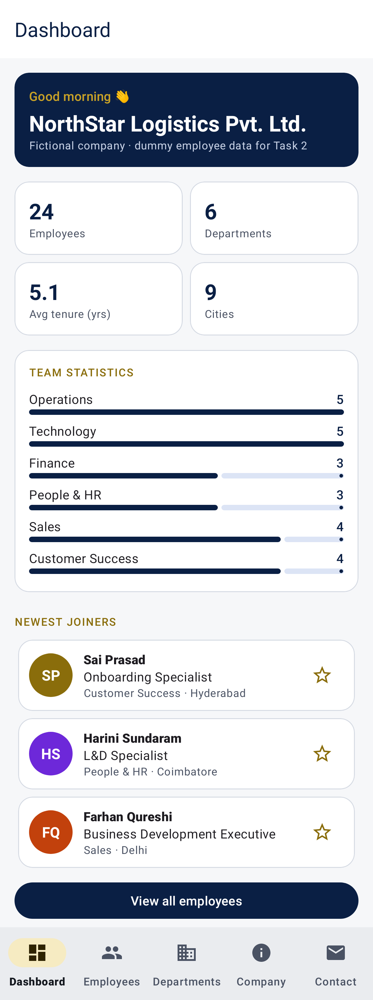 | 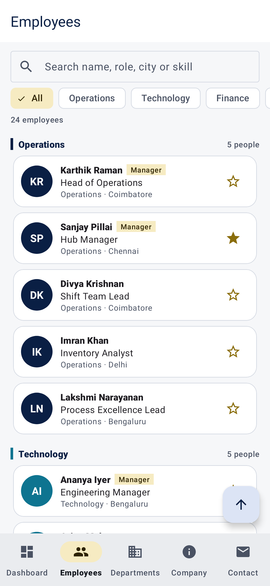 | 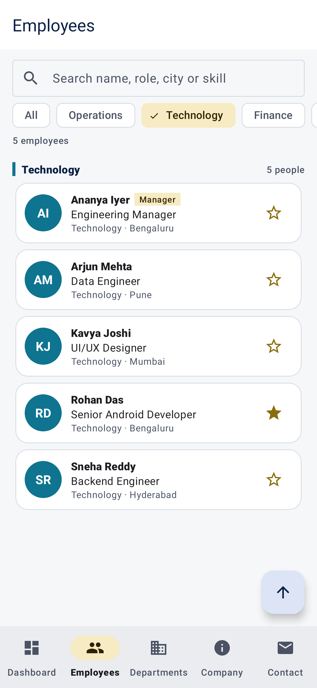 | 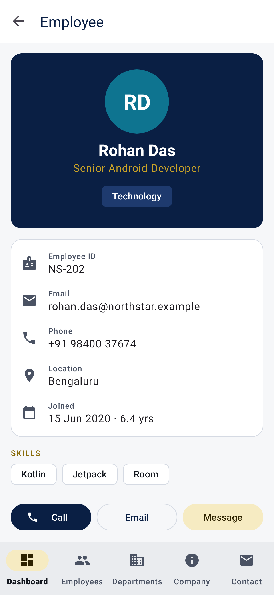 |

| Departments | Company | Contact | Employee list dark | Tablet two column list |
|---|---|---|---|---|
| 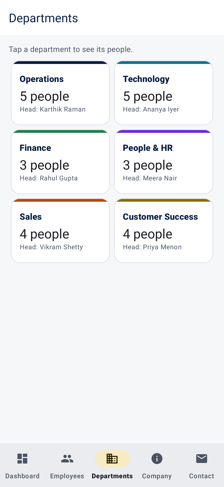 | 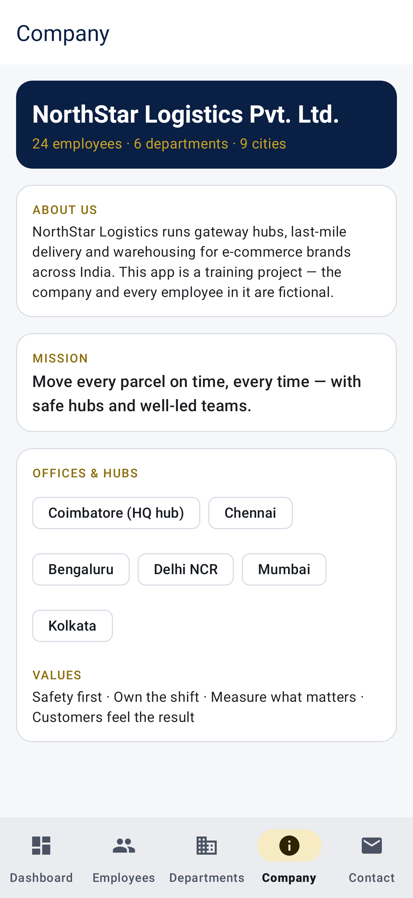 | 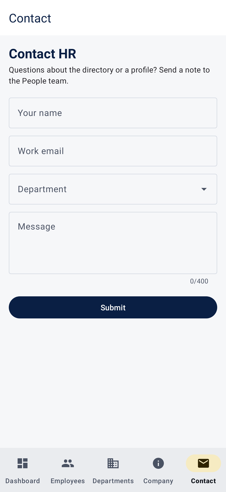 | 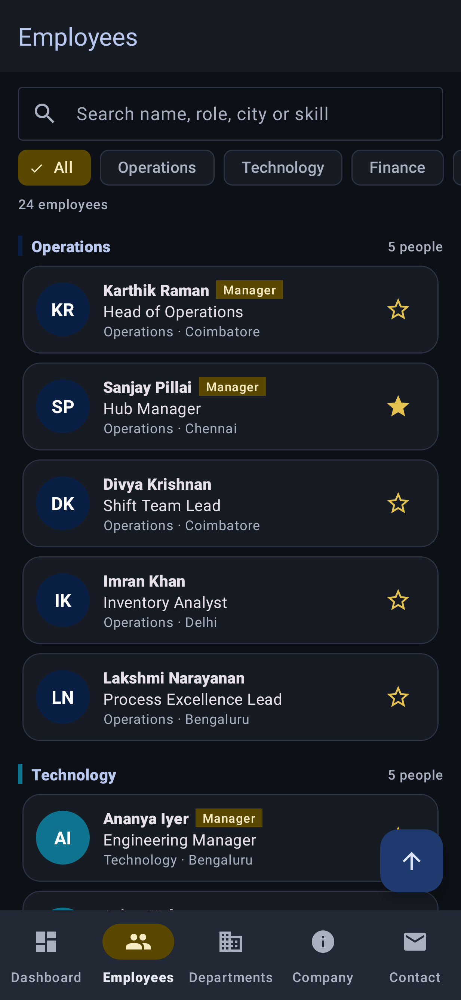 | 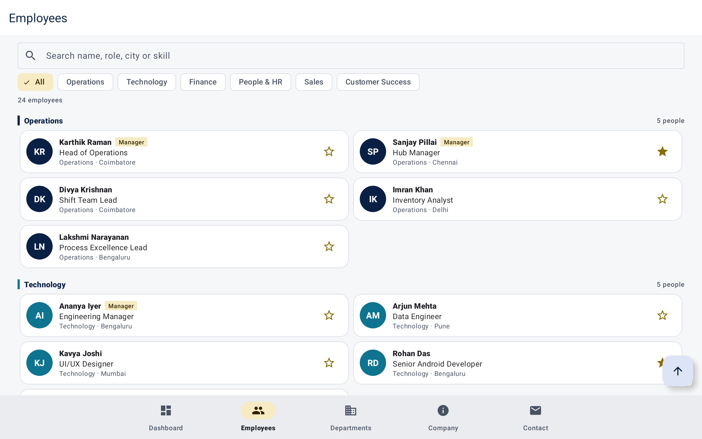 |

## Brief coverage
| Brief part | Where it is implemented |
|---|---|
| A – Advanced Kotlin | `model/EmployeeExtensions.kt`, `data/EmployeeRepository.kt` (collections, lambdas, scope functions) |
| B – OOP | `model/Person.kt` (interface + abstract class), `Employee.kt` (inheritance, polymorphism), `Department.kt` (enum) |
| C – Views | Cards, RecyclerView, NestedScrollView, Toolbar, FAB, Chip, Bottom Navigation |
| D – RecyclerView | `ui/adapter/DirectoryAdapter.kt` (2 view types, DiffUtil, click lambdas), `DepartmentAdapter.kt` |
| E – Fragments | 6 Fragments; data passed with Safe Args; lifecycle-safe binding |
| F – View Binding | `viewBinding = true`; no `findViewById` in the codebase |
| G – Navigation Component | `res/navigation/nav_graph.xml`, NavController + BottomNavigationView, back stack |
| H – Material Design 3 | Top App Bar, Bottom Navigation, cards, chips, FAB, Snackbar, dialog |
| I – Dynamic UI | 24 fictional employees, 6 departments, responsive grid (`list_span` 1 phone / 2 tablet) |
| J/K – Mini project & challenge | Dashboard, list, details, departments, company info, contact, bottom nav |

## Architecture
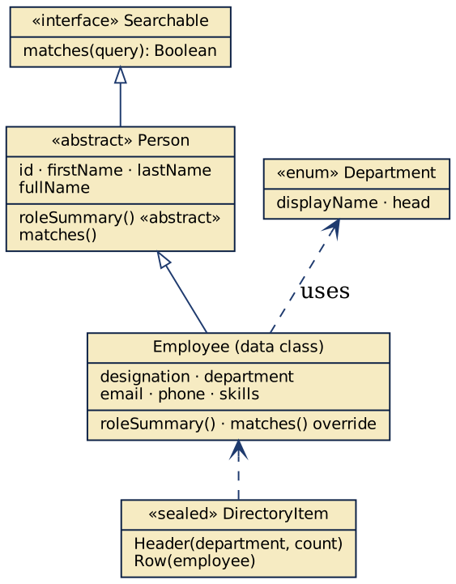
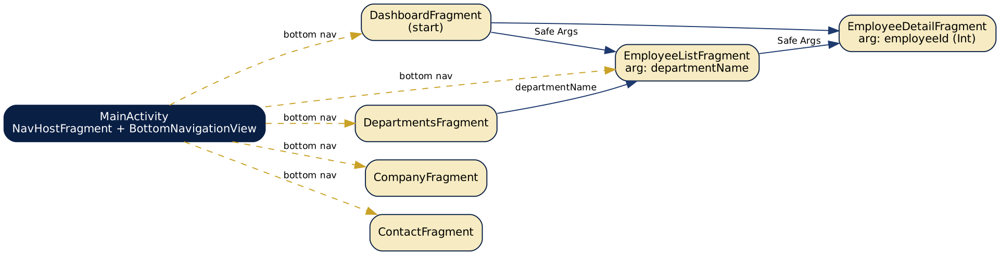
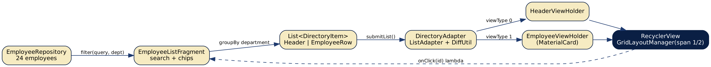

## Tests — 17 passing, 0 failing
| Test class | Tests | Cases |
|---|---|---|
| EmployeeLogicTest | 5 | `searchMatchesNameRoleCityAndSkill`, `favouriteToggleIsReversible`, `repositoryHasTwentyFourEmployeesInSixDepartments`, `extensionsAndTenure`, `departmentFilterAndSectionHeaders` |
| NavigationTest | 3 | `tappingAnEmployeeOpensDetailWithSafeArgs`, `startsOnDashboardAndBottomNavSwitchesFragments`, `departmentArgumentFiltersTheList` |
| ScreenshotTest | 9 | `s06_company`, `s03_filtered`, `s02_employees`, `s04_detail`, `s08_dark`, `s05_departments`, `s09_tablet`, `s07_contact`, `s01_dashboard` |

```bash
./gradlew testDebugUnitTest          # unit + Robolectric tests (also records screenshots)
./gradlew assembleDebug              # builds app/build/outputs/apk/debug/app-debug.apk
```

## Build & run
1. Open this folder in **Android Studio** (Ladybug or newer) — it syncs with the Gradle wrapper (8.14.3) and AGP 8.7.3.
2. Run the `app` configuration on an emulator or device (Android 8.0 / API 26+).
3. Kotlin 2.0.21 · compileSdk / targetSdk 35 · minSdk 26 · Material Components 1.12.

## Project structure
```
src/
  main/
    AndroidManifest.xml
    java/
      com/
        eswar/
          employeedirectory/
            data/
              EmployeeRepository.kt
            model/
              Department.kt
              Employee.kt
              EmployeeExtensions.kt
              Person.kt
            ui/
              MainActivity.kt
              UiExtensions.kt
              adapter/
                DepartmentAdapter.kt
                DirectoryAdapter.kt
              company/
                CompanyFragment.kt
              contact/
                ContactFragment.kt
              dashboard/
                DashboardFragment.kt
              departments/
                DepartmentsFragment.kt
              detail/
                EmployeeDetailFragment.kt
              list/
                EmployeeListFragment.kt
    res/
      drawable/
        bg_avatar_circle.xml
        ic_add.xml
        ic_apartment.xml
        ic_arrow_up.xml
        ic_badge.xml
        ic_calendar.xml
        ic_chevron.xml
        ic_cloud_off.xml
        ic_dashboard.xml
        ic_delete.xml
        ic_edit.xml
        ic_info.xml
        ic_launcher_foreground.xml
        ic_location.xml
        ic_mail.xml
        ic_payments.xml
        ic_people.xml
        ic_phone.xml
        ic_search.xml
        ic_sort.xml
        ic_star.xml
        ic_star_border.xml
      layout/
        activity_main.xml
        fragment_company.xml
        fragment_contact.xml
        fragment_dashboard.xml
        fragment_departments.xml
        fragment_employee_detail.xml
        fragment_employee_list.xml
        item_department.xml
        item_department_header.xml
        item_employee.xml
        item_info_row.xml
        item_team_stat.xml
        view_filter_chip.xml
        view_skill_chip.xml
        view_stat_card.xml
        view_text_card.xml
        view_text_card_mission.xml
      menu/
        bottom_nav.xml
      mipmap-anydpi-v26/
        ic_launcher.xml
      navigation/
        nav_graph.xml
      values/
        colors.xml
        dimens.xml
        ic_launcher_background.xml
        strings.xml
        themes.xml
      values-night/
        colors.xml
      values-sw600dp/
        dimens.xml
  test/
    java/
      com/
        eswar/
          employeedirectory/
            EmployeeLogicTest.kt
            ui/
              NavigationTest.kt
              ScreenshotTest.kt
    resources/
```

Detailed write-up: [docs/Project_Documentation.pdf](docs/Project_Documentation.pdf)
