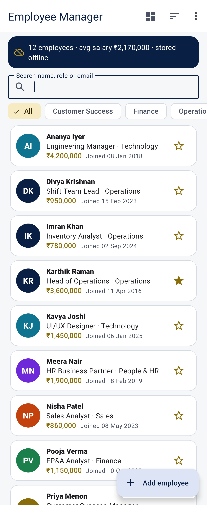
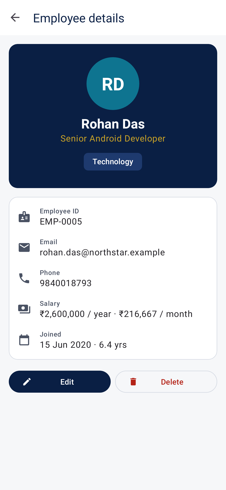
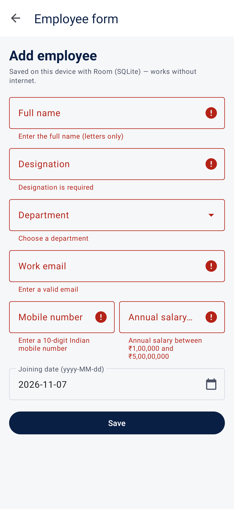
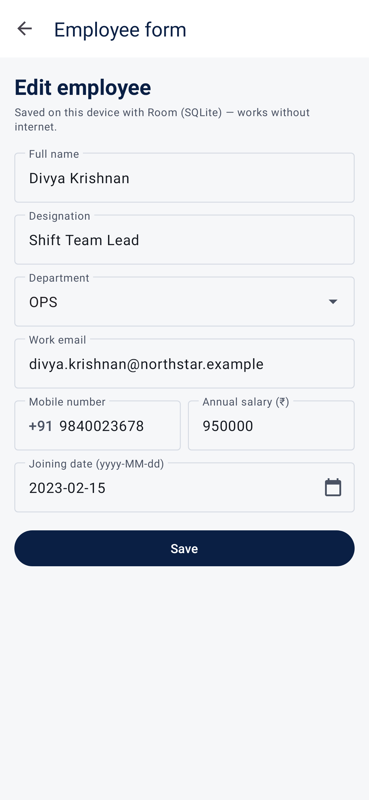
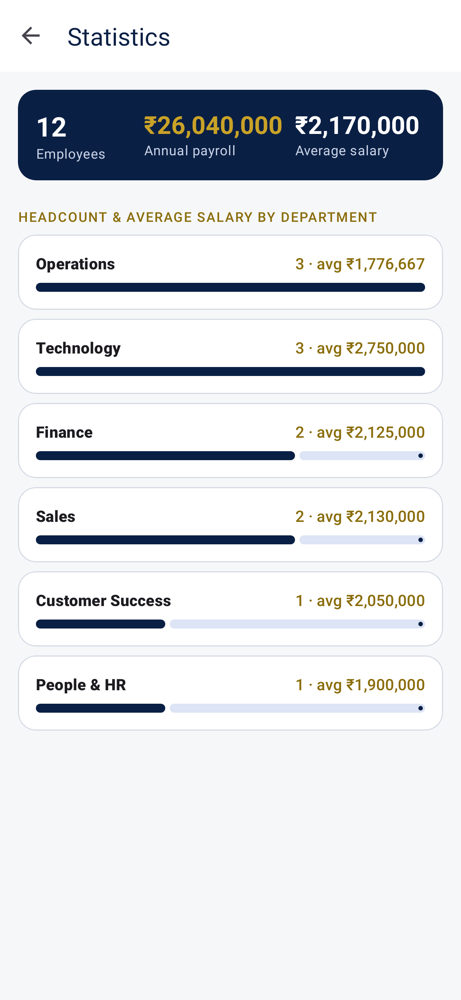
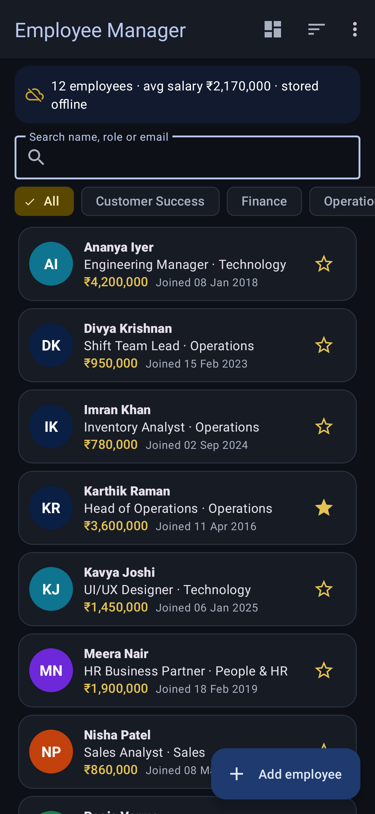
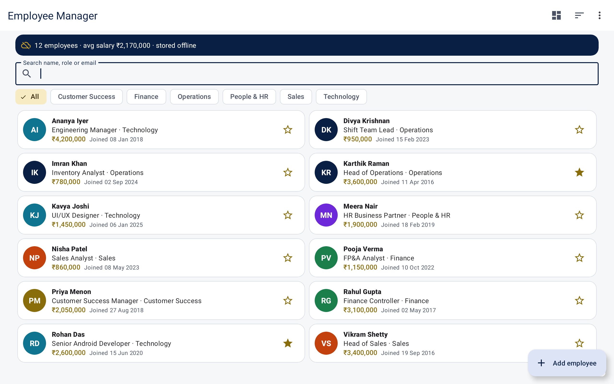
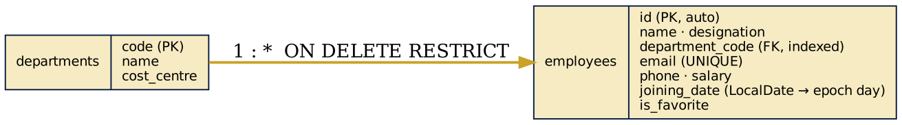
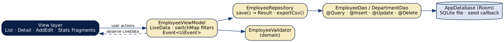

# Task 3 — Offline Employee Manager

**Intern:** Eswar Mahalingam · **Programme:** Sumerix Global — Android App Development · **Batch start:** 15 October 2026 · **Duration:** 36 weeks · **College / Organisation:** SRM University

Jetpack architecture components, MVVM, Room database, ViewModel, LiveData, Repository pattern and offline persistence.

## Features
- **MVVM**: Fragments observe `EmployeeViewModel` (LiveData + `switchMap` filters) → `EmployeeRepository` → Room DAOs
- **Room** database with two entities (departments 1 : * employees), foreign key, unique e-mail index, `@Relation`, GROUP BY statistics, TypeConverters and exported schema JSON
- Full CRUD offline: add / edit with field validation, swipe-to-delete with **Undo**, search, department filter and sort menu
- Seeded on first launch (6 departments, 12 employees) through a `RoomDatabase.Callback`
- Statistics screen (head-count and payroll by department) and CSV export through the share sheet
- One-shot UI events (`Event` wrapper) for Snackbars and navigation; dark theme and tablet grid

## Screenshots
Rendered from the real layouts with Robolectric + Roborazzi (Pixel-class phone, dark theme and 10-inch tablet configurations).

| Employee list | Employee detail | Add employee validation | Edit employee |
|---|---|---|---|
|  |  |  |  |

| Statistics | Employee list dark | Tablet two column |
|---|---|---|
|  |  |  |

## Brief coverage
| Brief part | Where it is implemented |
|---|---|
| Jetpack architecture | ViewModel, LiveData, Room, Navigation, lifecycle-aware observers |
| MVVM | `ui/EmployeeViewModel.kt`, Fragments in `ui/list`, `ui/detail`, `ui/edit`, `ui/stats` |
| Room / SQLite | `data/Entities.kt`, `EmployeeDao.kt`, `AppDatabase.kt`, `Converters.kt`, `app/schemas/…/1.json` |
| Repository pattern | `data/EmployeeRepository.kt` — single source of truth, `Result`-based save, duplicate-email handling |
| Data persistence & offline | Everything runs from the local database; no network permission |
| Validation | `domain/EmployeeForm.kt` — `EmployeeValidator` with unit tests |
| Testing | DAO tests on an in-memory database, ViewModel and validator tests, screenshot tests |

## Architecture



## Tests — 17 passing, 0 failing
| Test class | Tests | Cases |
|---|---|---|
| EmployeeDaoTest | 4 | `searchFiltersAndSorts`, `duplicateEmailIsRejectedNotCrashing`, `insertReadUpdateDelete`, `relationAndAggregates` |
| EmployeeValidatorTest | 3 | `everyFieldIsChecked`, `futureJoiningDateRejected`, `validFormIsNormalised` |
| EmployeeViewModelTest | 3 | `invalidFormExposesErrorsAndDoesNotSave`, `filterChangesRequeryRoom`, `validFormIsInsertedThenDeletedAndRestored` |
| ScreenshotTest | 7 | `s05_stats`, `s03_add_validation`, `s01_list`, `s04_edit`, `s06_dark`, `s02_detail`, `s07_tablet` |

```bash
./gradlew testDebugUnitTest          # unit + Robolectric tests (also records screenshots)
./gradlew assembleDebug              # builds app/build/outputs/apk/debug/app-debug.apk
```

## Build & run
1. Open this folder in **Android Studio** (Ladybug or newer) — it syncs with the Gradle wrapper (8.14.3) and AGP 8.7.3.
2. Run the `app` configuration on an emulator or device (Android 8.0 / API 26+).
3. Kotlin 2.0.21 · compileSdk / targetSdk 35 · minSdk 26 · Material Components 1.12.

## Project structure
```
src/
  main/
    AndroidManifest.xml
    java/
      com/
        eswar/
          employeemanager/
            EmployeeManagerApp.kt
            data/
              AppDatabase.kt
              Converters.kt
              EmployeeDao.kt
              EmployeeRepository.kt
              Entities.kt
              SeedData.kt
            domain/
              EmployeeForm.kt
            ui/
              EmployeeViewModel.kt
              Format.kt
              MainActivity.kt
              detail/
                EmployeeDetailFragment.kt
              edit/
                AddEditEmployeeFragment.kt
              list/
                EmployeeAdapter.kt
                EmployeeListFragment.kt
              stats/
                StatsFragment.kt
    res/
      drawable/
        bg_avatar_circle.xml
        ic_add.xml
        ic_apartment.xml
        ic_arrow_up.xml
        ic_badge.xml
        ic_calendar.xml
        ic_chevron.xml
        ic_cloud_off.xml
        ic_dashboard.xml
        ic_delete.xml
        ic_edit.xml
        ic_info.xml
        ic_launcher_foreground.xml
        ic_location.xml
        ic_mail.xml
        ic_payments.xml
        ic_people.xml
        ic_phone.xml
        ic_search.xml
        ic_sort.xml
        ic_star.xml
        ic_star_border.xml
      layout/
        activity_main.xml
        fragment_add_edit.xml
        fragment_detail.xml
        fragment_employee_list.xml
        fragment_stats.xml
        item_employee.xml
        item_info_row.xml
        item_stat_row.xml
        view_filter_chip.xml
      menu/
        menu_list.xml
      mipmap-anydpi-v26/
        ic_launcher.xml
      navigation/
        nav_graph.xml
      values/
        colors.xml
        dimens.xml
        ic_launcher_background.xml
        strings.xml
        themes.xml
      values-night/
        colors.xml
      values-sw600dp/
        dimens.xml
  test/
    java/
      com/
        eswar/
          employeemanager/
            data/
              EmployeeDaoTest.kt
            domain/
              EmployeeValidatorTest.kt
            ui/
              EmployeeViewModelTest.kt
              ScreenshotTest.kt
    resources/
```

Detailed write-up: [docs/Project_Documentation.pdf](docs/Project_Documentation.pdf)
