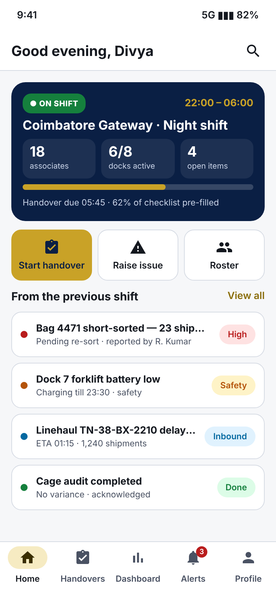

# UI/UX Design & Product Design — ShiftLoop

**Intern:** Eswar Mahalingam · **Programme:** Sumerix Global — UI/UX Design & Product Design · **Batch start:** 15 October 2026 · **Duration:** 36 weeks · **College / Organisation:** SRM University

**ShiftLoop** is a mobile-first, offline-first app that turns the end-of-shift handover at a logistics gateway hub into a guided 6-section checklist with photo/voice evidence and an explicit acknowledgement by the incoming team lead. One product is carried through every task so each deliverable builds on the previous one.

| Task | Folder | Main deliverable | Highlights |
|---|---|---|---|
| 1 — User Research & Problem Discovery | [Task-1-User-Research-Discovery](Task-1-User-Research-Discovery) | [User_Research_Report_ShiftLoop.pdf](Task-1-User-Research-Discovery/User_Research_Report_ShiftLoop.pdf) · [Research_Presentation_ShiftLoop.pdf](Task-1-User-Research-Discovery/Research_Presentation_ShiftLoop.pdf) | UI vs UX, Design Thinking, survey (12 Q) + interview guide, competitor analysis, 2 personas, empathy map, problem statement, goals & metrics, workspace setup |
| 2 — IA, User Flows & Wireframes | [Task-2-IA-UserFlows-Wireframes](Task-2-IA-UserFlows-Wireframes) | [UX_Documentation_Report_ShiftLoop.pdf](Task-2-IA-UserFlows-Wireframes/UX_Documentation_Report_ShiftLoop.pdf) | IA, content inventory, 5 user flows with error paths, journey map, card sort, sitemap, 13 low-fi wireframes |
| 3 — Design System & High-Fidelity UI | [Task-3-Design-System-HiFi-UI](Task-3-Design-System-HiFi-UI) | [Design_Documentation_ShiftLoop.pdf](Task-3-Design-System-HiFi-UI/Design_Documentation_ShiftLoop.pdf) | Design tokens (JSON), type & colour guides, component library, 13 hi-fi screens (light + dark), tablet & desktop layouts, computed WCAG contrast audit |

## How the designs were produced
Screens are authored as HTML/CSS driven by one set of design tokens and rendered to PNG at 390 × 844 (2×). Low-fidelity wireframes are the *same* screens rendered with a grayscale wireframe stylesheet, so structure carries from Task 2 into Task 3 exactly. Diagrams are generated from Graphviz/Mermaid sources, and contrast ratios are computed from the token values — nothing in the audit is eyeballed.

**Figma:** the PNG screens and live HTML pages can be imported into Figma (File ▸ Import for PNGs, or the *html.to.design* plugin for editable layers). The Figma share link will be added here once the team file is set up.

## Research integrity
The survey, interview guide and analysis pipeline are complete, but the 8 pilot rows used to build the charts are **declared synthetic** and the card-sort counts are a **simulated rehearsal**. Both are clearly labelled in file names and reports and must be replaced with real responses from hub colleagues before findings are quoted.
