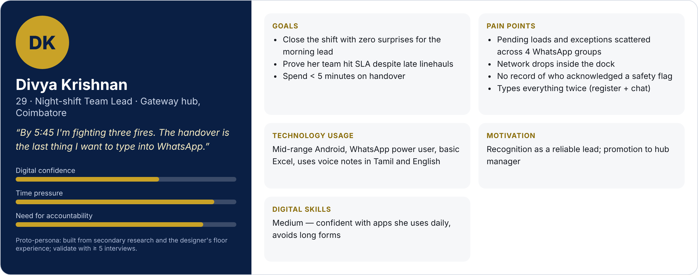
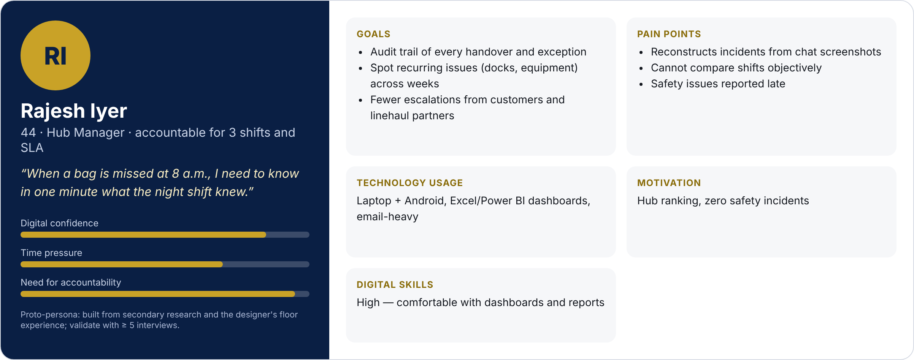

# Task 1 — User Research & Problem Discovery (ShiftLoop)

**Intern:** Eswar Mahalingam · **Programme:** Sumerix Global — UI/UX Design & Product Design · **Batch start:** 15 October 2026 · **Duration:** 36 weeks · **College / Organisation:** SRM University

## Deliverables
| Brief item | Where |
|---|---|
| Research report (PDF) | [User_Research_Report_ShiftLoop.pdf](User_Research_Report_ShiftLoop.pdf) |
| Research presentation (10 slides) | [Research_Presentation_ShiftLoop.pdf](Research_Presentation_ShiftLoop.pdf) |
| Part A — UI vs UX with real apps | report §2 · [docs/ui_ux_fundamentals.md](docs/ui_ux_fundamentals.md) |
| Part B — Design Thinking & Double Diamond | report §3 |
| Part C — Primary & secondary research | report §4–5 · [research/survey_questionnaire.md](research/survey_questionnaire.md) · [response template](research/survey_response_template.csv) |
| Part D — Competitor analysis | [assets/competitor_analysis.png](assets/competitor_analysis.png) · [docs/competitor_analysis.md](docs/competitor_analysis.md) |
| Part E — User personas (2) | [assets/persona_1_divya.png](assets/persona_1_divya.png) · [assets/persona_2_rajesh.png](assets/persona_2_rajesh.png) · [docs/personas.md](docs/personas.md) |
| Part F — Empathy map | [assets/empathy_map.png](assets/empathy_map.png) · [docs/empathy_map.md](docs/empathy_map.md) |
| Problem statement & HMW | [docs/problem_statement.md](docs/problem_statement.md) |
| Goals & success metrics | [docs/project_goals.md](docs/project_goals.md) |
| Part G — Design workspace, naming & versioning | report §9 |
| Part H — Documentation | this README + [DAILY_PROGRESS_LOG.md](DAILY_PROGRESS_LOG.md) |

## Problem in one line
Hub team leads hand over pending loads, exceptions and safety status through WhatsApp, paper and memory — items get missed and nobody can prove a safety flag was acknowledged.

## Personas
| Divya Krishnan — Night-shift Team Lead | Rajesh Iyer — Hub Manager |
|---|---|
|  |  |

## Research status
- Survey (12 questions) and interview guide (9 prompts) are ready to run with ≥ 5 hub colleagues.
- `research/pilot_responses_DECLARED_SYNTHETIC.csv` contains 8 **synthetic** rows used only to build the charts; replace them with the Google-Forms export (same columns) and re-render.
- Secondary sources are cited at the end of the report.
