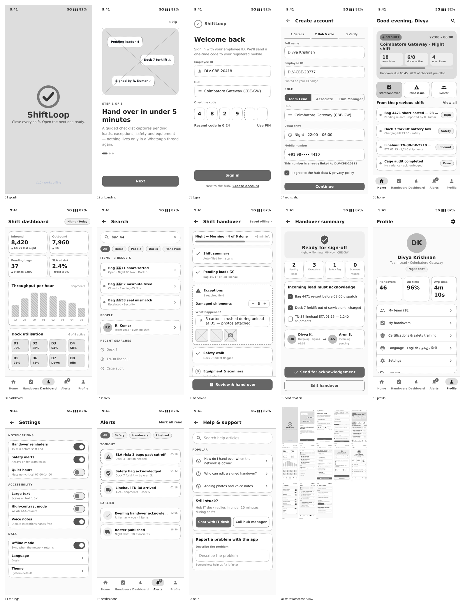

# Task 2 — Information Architecture, User Flows & Wireframes (ShiftLoop)

**Intern:** Eswar Mahalingam · **Programme:** Sumerix Global — UI/UX Design & Product Design · **Batch start:** 15 October 2026 · **Duration:** 36 weeks · **College / Organisation:** SRM University

## Deliverables
| Brief item | Where |
|---|---|
| UX documentation report (PDF) | [UX_Documentation_Report_ShiftLoop.pdf](UX_Documentation_Report_ShiftLoop.pdf) |
| Part A — Information architecture | [diagrams/information_architecture.png](diagrams/information_architecture.png) |
| Part B — Content strategy & inventory | [docs/content_inventory.md](docs/content_inventory.md) · [CSV](docs/content_inventory.csv) |
| Part C — 5 user flows (registration, login, main task, confirmation, logout) | [diagrams/](diagrams) `flow_1…flow_5` |
| Part D — Customer journey map | [diagrams/customer_journey_map.png](diagrams/customer_journey_map.png) |
| Part E — Card sorting | [diagrams/card_sort_matrix.png](diagrams/card_sort_matrix.png) · [results (SIMULATED)](docs/card_sort_results_SIMULATED.csv) |
| Part F — Sitemap | [diagrams/sitemap.png](diagrams/sitemap.png) |
| Part G — 13 low-fidelity wireframes | [wireframes/](wireframes) · [overview sheet](wireframes/_all_wireframes_overview.png) |
| Part H — Documentation | this README + report + [DAILY_PROGRESS_LOG.md](DAILY_PROGRESS_LOG.md) |

## Key structure decisions
- **5 bottom-nav tabs:** Home · Handovers · Dashboard · Alerts · Profile; Search and offline status are global.
- **Handover is a first-class tab** (top research pain point) and Alerts are separate so safety items are never buried.
- **Every flow has an error path** with a recovery action (resend OTP, PIN fallback, offline queue, escalation after 15 min, unsynced-logout guard).

Card-sort counts are a **simulated rehearsal** (labelled in the file name); the real hybrid sort with 8 colleagues replaces them.
