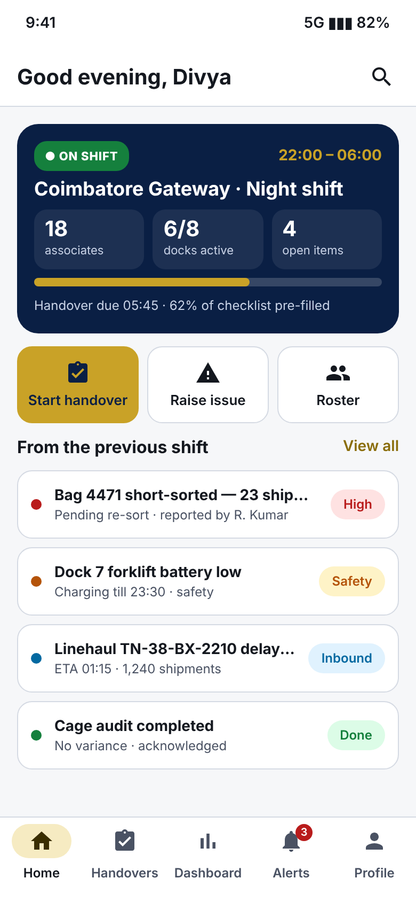
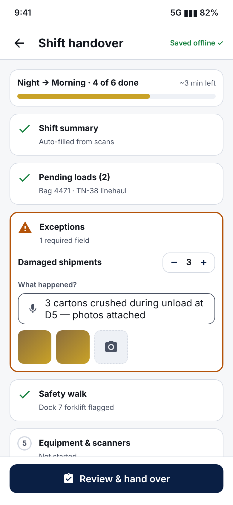
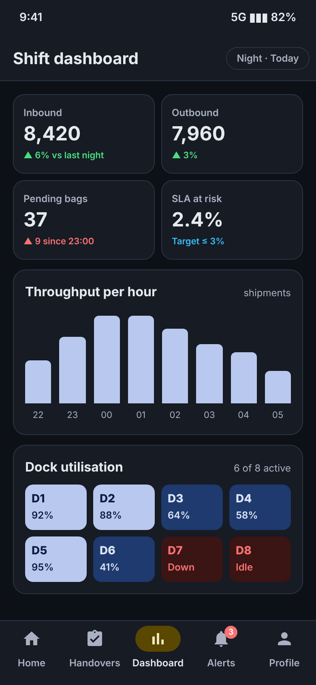
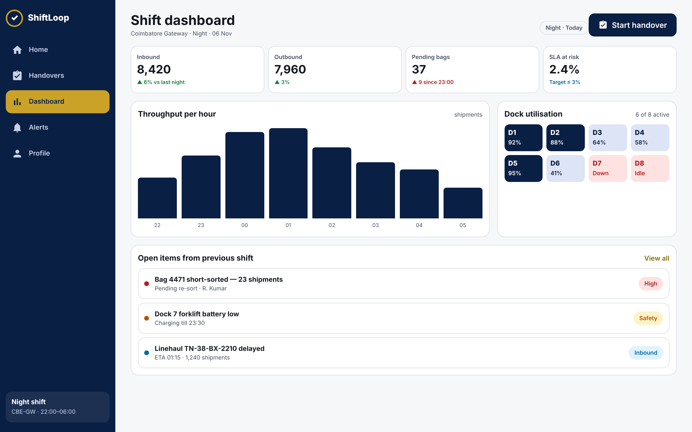

# Task 3 — Design System & High-Fidelity UI (ShiftLoop)

**Intern:** Eswar Mahalingam · **Programme:** Sumerix Global — UI/UX Design & Product Design · **Batch start:** 15 October 2026 · **Duration:** 36 weeks · **College / Organisation:** SRM University

## Deliverables
| Brief item | Where |
|---|---|
| Design documentation (PDF) | [Design_Documentation_ShiftLoop.pdf](Design_Documentation_ShiftLoop.pdf) |
| Part A — Design system foundations | [design-system/design_system_foundations.png](design-system/design_system_foundations.png) · [design-tokens.json](design-system/design-tokens.json) |
| Parts B & C — Typography & colour guides | report §3 · tokens JSON |
| Part D — Layout & grid (4/8/12 columns) | report §4 |
| Part E — Component library | [design-system/component_library.png](design-system/component_library.png) |
| Part F — Accessibility audit (computed WCAG contrast) | [docs/accessibility_audit.md](docs/accessibility_audit.md) · report §8 |
| Part G — 13 high-fidelity screens (+ dark theme) | [hifi-screens/](hifi-screens) · [hifi-screens/dark/](hifi-screens/dark) |
| Part H — Responsive (tablet 834, desktop 1440) | [responsive/](responsive) |
| Live HTML screens | [prototype-html/index.html](prototype-html/index.html) |
| Documentation | this README + [DAILY_PROGRESS_LOG.md](DAILY_PROGRESS_LOG.md) |

| Home | Handover | Dashboard (dark) |
|---|---|---|
|  |  |  |

## Accessibility summary
All text/background token pairs were computed with the WCAG 2.x relative-luminance formula. The single failing pair — **gold #C9A227 as text on white (≈2.3:1)** — is resolved by rule: gold is decorative only, and text links use accent-strong **#8A6D0B**. Touch targets are ≥ 48 dp, status is never colour-only, and text scales to 200%.

## Developer handoff
`design-tokens.json` holds colour (light/dark), type scale, spacing (4-pt base), radii, elevation and grid. Open `prototype-html/index.html` in a browser to inspect any screen's live CSS.
