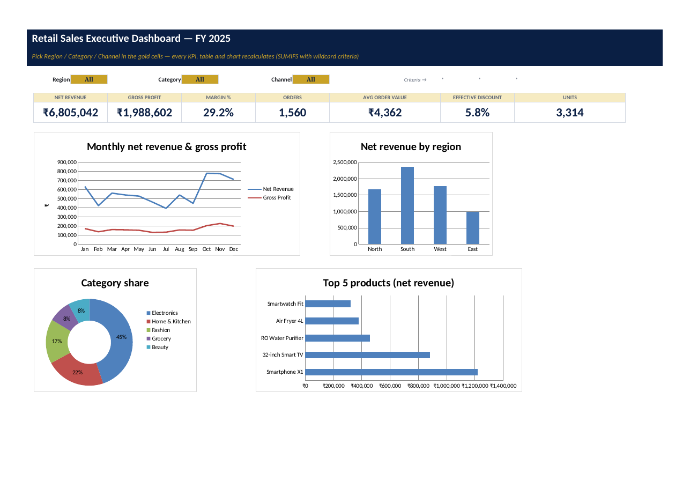
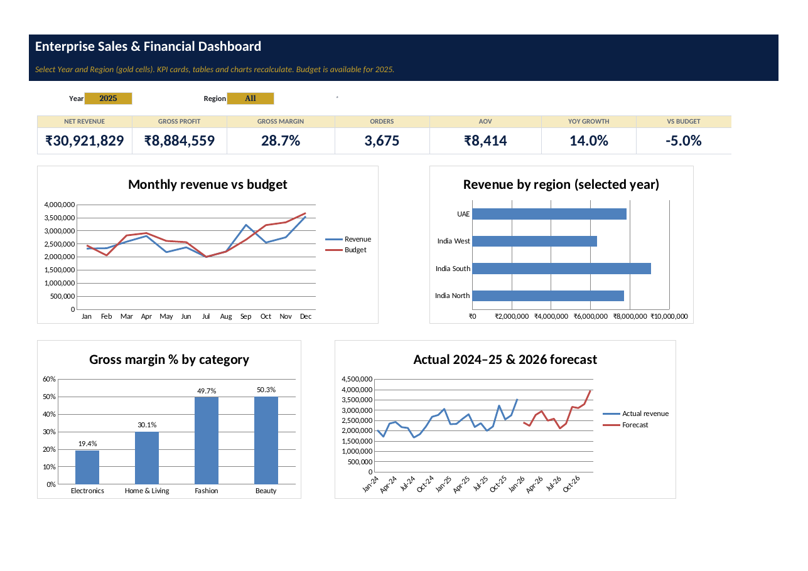

# Business Analytics (Excel + Power BI)

**Intern:** Eswar Mahalingam · **Programme:** Sumerix Global — Business Analytics (Excel + Power BI) · **Batch start:** 15 October 2026 · **Duration:** 36 weeks · **College / Organisation:** SRM University

| Task | Folder | Workbook | Report | Highlights |
|---|---|---|---|---|
| 1 — Retail Sales Analysis & Executive Dashboard | [Task-1-Retail-Sales-Executive-Dashboard](Task-1-Retail-Sales-Executive-Dashboard) | [Retail_Sales_Executive_Dashboard_Eswar.xlsx](Task-1-Retail-Sales-Executive-Dashboard/workbook/Retail_Sales_Executive_Dashboard_Eswar.xlsx) | [Business report (PDF)](Task-1-Retail-Sales-Executive-Dashboard/Business_Report_Retail_Sales_Eswar.pdf) | 10-step cleaning log with live reconciliation, 29-function lab, 6 pivot views, interactive dashboard with 3 selectors |
| 2 — Enterprise Sales Performance & Financial Analysis | [Task-2-Enterprise-Sales-Financial-Dashboard](Task-2-Enterprise-Sales-Financial-Dashboard) | [Enterprise_Sales_Financial_Dashboard_Eswar.xlsx](Task-2-Enterprise-Sales-Financial-Dashboard/workbook/Enterprise_Sales_Financial_Dashboard_Eswar.xlsx) | [Executive report (PDF)](Task-2-Enterprise-Sales-Financial-Dashboard/Executive_Business_Report_Eswar.pdf) | Power Query M for 4 source layouts, star schema + 15 DAX measures, P&L / break-even / NPV-IRR, forecast, scenarios, goal seek, data tables |

| Task 1 dashboard | Task 2 dashboard |
|---|---|
|  |  |

**Data:** both datasets are **declared synthetic** (fixed random seeds), built to mimic real retail patterns and to contain realistic data-quality problems. No real company data is used.

**Verification:** every workbook was recalculated headlessly in LibreOffice 24.2 and the KPIs were reconciled with an independent pandas calculation (e.g. Task 2 FY2025 revenue ₹30,921,829.23 and gross profit ₹8,884,559.23 match to the paisa). Only the Excel 365 dynamic-array demos (XLOOKUP, FILTER, SORT, UNIQUE …) need Excel 2021 / Microsoft 365 to evaluate.
