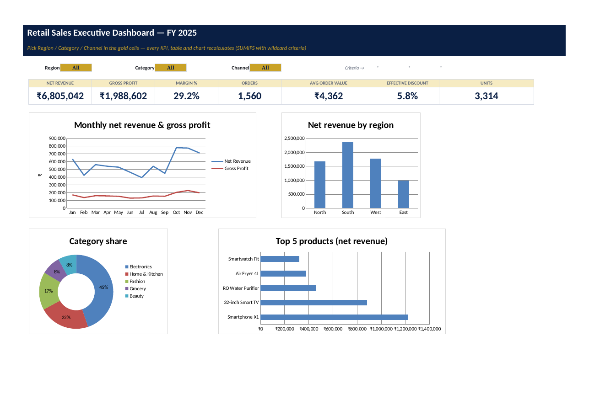

# Task 1 — Retail Sales Analysis & Executive Dashboard

**Intern:** Eswar Mahalingam · **Programme:** Sumerix Global — Business Analytics (Excel + Power BI) · **Batch start:** 15 October 2026 · **Duration:** 36 weeks · **College / Organisation:** SRM University

## Business problem
A retail chain with 8 branches receives raw branch spreadsheets every month; management cannot see trends, top products, customer behaviour or regional performance without days of manual work.

## Deliverables
| Brief item | Where |
|---|---|
| Excel workbook (all parts) | [workbook/Retail_Sales_Executive_Dashboard_Eswar.xlsx](workbook/Retail_Sales_Executive_Dashboard_Eswar.xlsx) |
| Business report (PDF) | [Business_Report_Retail_Sales_Eswar.pdf](Business_Report_Retail_Sales_Eswar.pdf) |
| Raw data (untouched) | [data/raw](data/raw) · sheet `Raw_Data` |
| Data cleaning & validation | sheet `Data_Cleaning_Log` (10 steps + live reconciliation) · [data/clean](data/clean) · sheet `Clean_Data` (Excel Table `tblSales`) |
| Excel functions | sheet `Functions_Lab` — 29 functions with formula text and live result |
| Business calculations | sheet `KPI_Calculations` — revenue, profit, margin, discount, growth, target achievement |
| Pivot analysis | sheet `Pivot_Summary` — 6 views + native PivotTable / Slicer / Timeline steps on `README` |
| Interactive dashboard | sheet `Dashboard` — Region / Category / Channel selectors, 7 KPI cards, 4 charts |
| Executive report | sheet `Executive_Report` (live text) + PDF |
| Screenshots | [docs/screenshots](docs/screenshots) |

## Headline results (FY2025, declared-synthetic data)
- Net revenue **₹6,805,042** from 1,560 orders (AOV ₹4,362); gross margin **29.2%**; **99%** of the company target.
- Q4 revenue was **64% above Q3** (festive season); H2 grew 16% over H1.
- Electronics is the largest category but the thinnest margin (21.0%) vs Fashion (48.9%).
- South contributes 35% of revenue; Delhi, Chennai and Kolkata finished below target.

## How to use
Open the workbook in Excel 2021 / Microsoft 365, go to **Dashboard** and change the gold selector cells. Every number is a formula over `tblSales`, so pasting next month's cleaned data into the table refreshes everything.
