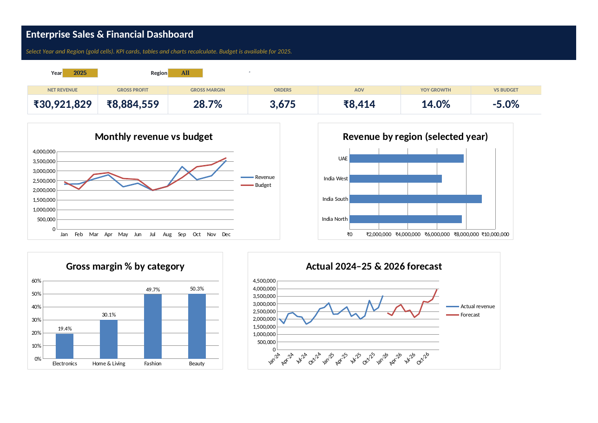

# Task 2 — Enterprise Sales Performance & Financial Analysis Dashboard

**Intern:** Eswar Mahalingam · **Programme:** Sumerix Global — Business Analytics (Excel + Power BI) · **Batch start:** 15 October 2026 · **Duration:** 36 weeks · **College / Organisation:** SRM University

## Industry challenge
A retailer with 8 stores in India and 2 in the UAE receives monthly extracts in four different layouts (CSV, Excel, semicolon CSV, AED prices) with text dates, duplicates and blanks. Manual consolidation takes days and produces inconsistent reports.

## Deliverables
| Brief item | Where |
|---|---|
| Excel workbook | [workbook/Enterprise_Sales_Financial_Dashboard_Eswar.xlsx](workbook/Enterprise_Sales_Financial_Dashboard_Eswar.xlsx) |
| Executive report (PDF) | [Executive_Business_Report_Eswar.pdf](Executive_Business_Report_Eswar.pdf) |
| Source extracts (4 layouts) + reference data | [data/raw](data/raw) · [data/reference](data/reference) |
| Power Query (M) — import, transform, merge, append | [power-query/](power-query) (12 queries + how-to) · sheet `PQ_Workflow` with live data-quality checks |
| Data model — star schema, relationships, DAX | [dax/measures.dax](dax/measures.dax) · [docs/star_schema.png](docs/star_schema.png) · sheet `Data_Model` |
| Advanced formulas | sheet `Advanced_Formulas` (IFS, SWITCH, XLOOKUP, XMATCH, FILTER, SORT, SORTBY, UNIQUE, SEQUENCE, statistical & financial) |
| KPIs & regional analysis | sheets `KPI_Monthly`, `Regional_Performance` |
| Financial model | sheet `Financial_Model` — P&L 2024A / 2025A / 2026 plan, break-even, NPV / IRR / payback / PMT / PV / FV |
| Forecasting | sheet `Forecast` — seasonal index × FORECAST.LINEAR trend with ±8% band |
| What-if analysis | sheet `What_If` — scenario selector, goal seek (solved algebraically too), 1- and 2-variable data tables |
| Interactive dashboard | sheet `Dashboard` — Year & Region selectors, 7 KPI cards, 4 charts |
| Executive report | sheet `Executive_Report` (live text) + PDF |
| Screenshots | [docs/screenshots](docs/screenshots) |

## Headline results (declared-synthetic data)
- FY2025 net revenue **₹30,921,829** (+14% YoY), gross margin **28.7%**, net profit **₹2,236,196** (7.2%).
- Revenue reached **95%** of the stretch budget; India South was weakest at 87%.
- FY2026 forecast **₹33,465,339** (+8%); the Base plan needs a 5.3% price change to reach the ₹40L EBIT target.
- ₹25L automation project: NPV ₹260,749 at 12%, IRR 16%, payback 3.4 years under the declared 2% savings assumption.

## Honest scope note
Power Query connections and the Power Pivot model cannot be created by a script, so the workbook ships with the query **output** loaded as Excel Tables plus the exact M code and DAX to wire them up (≈5 minutes, steps in [power-query/README.md](power-query/README.md)). Every KPI is also computed with worksheet formulas, so the file works even without the Data Model.
