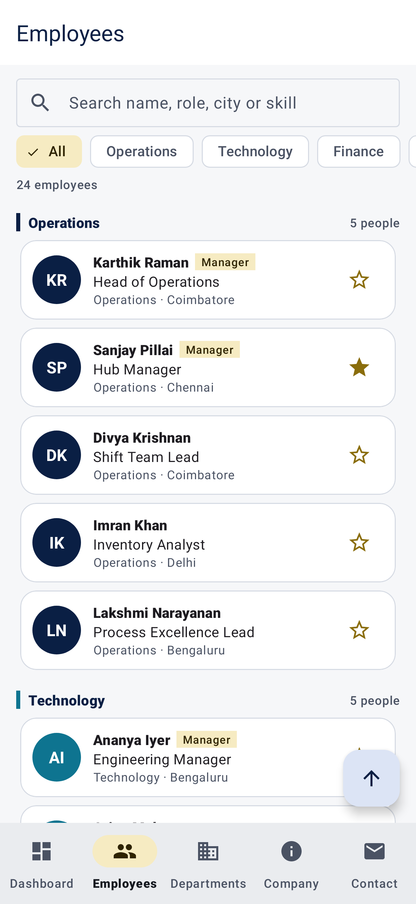
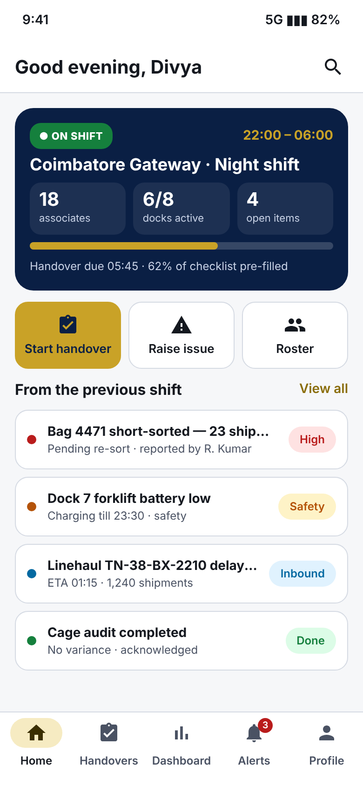
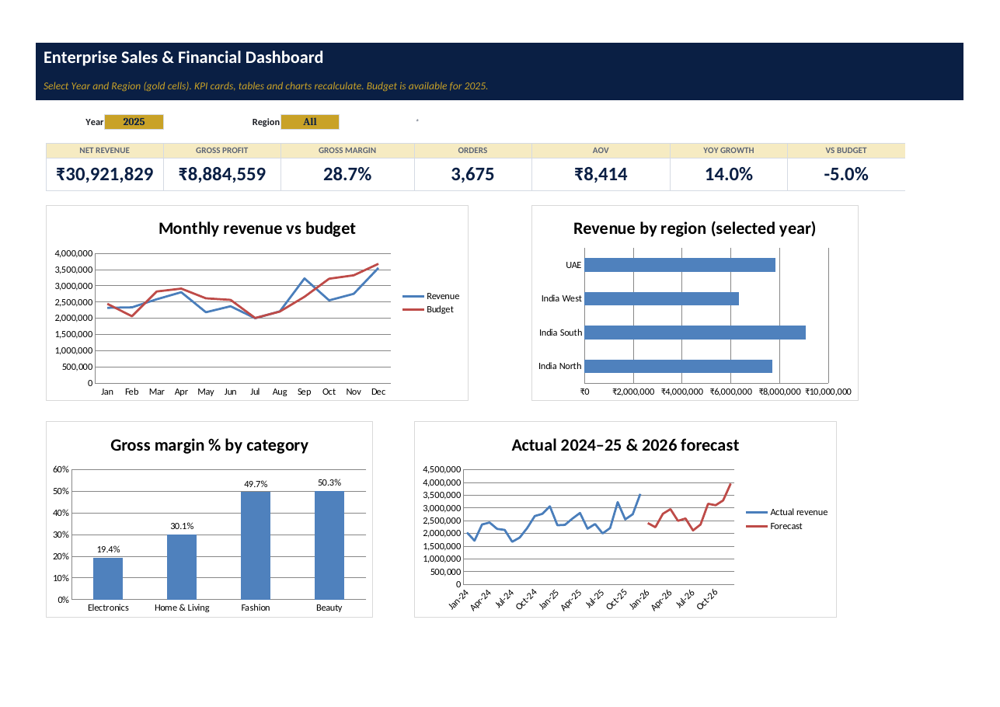

# Sumerix Global Internship Projects — 2026

| | |
|---|---|
| **Intern** | Eswar Mahalingam |
| **College / Organisation** | SRM University |
| **Programme** | Sumerix Global Internship |
| **Batch start** | 15 October 2026 |
| **Duration** | 36 weeks |

This repository contains my completed project tasks for three internship domains. Every task folder has its own README with the brief coverage, screenshots, results and instructions.

## 1 · Android App Development (Kotlin, XML, Material 3)

| Task | Project | Highlights |
|---|---|---|
| Task 1 | [Responsive Personal Profile App](01-Android-App-Development/Task-1-Personal-Profile-App) | Splash → Profile → About / Skills / Contact Activities with Intents, Material 3 light/dark, tablet layout · 16 tests |
| Task 2 | [Dynamic Employee Directory](01-Android-App-Development/Task-2-Employee-Directory) | Single-Activity + 6 Fragments, Navigation Component + Safe Args, RecyclerView (DiffUtil, multiple view types), View Binding, OOP model · 17 tests |
| Task 3 | [Offline Employee Manager](01-Android-App-Development/Task-3-Offline-Employee-Manager) | MVVM, Room (FK, unique index, @Relation, statistics), ViewModel + LiveData, Repository, validation, swipe-to-delete with undo, CSV export · 17 tests |

## 2 · UI/UX Design & Product Design — *ShiftLoop* hub shift-handover app

| Task | Folder | Highlights |
|---|---|---|
| Task 1 | [User Research & Problem Discovery](02-UI-UX-Design/Task-1-User-Research-Discovery) | UI vs UX, Design Thinking, survey + interview guide, competitor analysis, 2 personas, empathy map, problem statement, goals & metrics |
| Task 2 | [IA, User Flows & Wireframes](02-UI-UX-Design/Task-2-IA-UserFlows-Wireframes) | Information architecture, content inventory, 5 user flows, journey map, card sort, sitemap, 13 low-fidelity wireframes |
| Task 3 | [Design System & High-Fidelity UI](02-UI-UX-Design/Task-3-Design-System-HiFi-UI) | Design tokens, typography & colour guides, component library, 13 hi-fi screens (light + dark), responsive layouts, computed WCAG audit |

## 3 · Business Analytics (Excel + Power BI)

| Task | Folder | Highlights |
|---|---|---|
| Task 1 | [Retail Sales Analysis & Executive Dashboard](03-Business-Analytics/Task-1-Retail-Sales-Executive-Dashboard) | 10-step data cleaning with reconciliation, business KPIs, pivot analysis, interactive dashboard, executive report |
| Task 2 | [Enterprise Sales Performance & Financial Analysis](03-Business-Analytics/Task-2-Enterprise-Sales-Financial-Dashboard) | Power Query M for 4 source layouts, star schema + DAX, P&L / break-even / NPV-IRR, forecast, scenarios, goal seek, dashboard |

| Android · Employee Directory | UI/UX · ShiftLoop home | Analytics · Enterprise dashboard |
|---|---|---|
|  |  |  |

## Notes on data and research
- Analytics datasets are **declared synthetic** (fixed random seeds) and the Android apps use fictional employees; no real company or personal data is included.
- The UI/UX survey charts use a **declared-synthetic pilot** and the card sort is a **simulated rehearsal**; both are labelled in file names and reports and are meant to be replaced with real responses.
- Each task folder has a `DAILY_PROGRESS_LOG.md` or test results describing how the work was done and what comes next.
